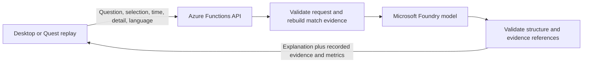

# Azure analyst integration

Prepared on **19 October 2026**. This is the proposed first Azure integration, not an implemented or deployed backend. The current app still uses its labelled scripted analyst. No Azure resource, model deployment, credential or billable request has been created by this work.

## First milestone

Make the existing replay explain its recorded football evidence through a genuine Microsoft Foundry model. Preserve the existing synthetic match, deterministic replay clock, desktop controls and WebXR movement safeguards.

The first release should answer the existing space, pass and selected-player questions, generate a recap from the event records, and produce different fan/analyst explanations in English and Spanish. Voice follows after the text integration is verified.



## Funding and access gate

Before creating resources or sending a real model request, confirm the intended subscription, available credits or separately approved budget, credit expiry, region, model availability and quota. Hackathon registration does not prove an Azure credit entitlement. An advertised free trial does not prove eligibility or access to a particular model.

The user's current instruction keeps spending conditional on confirmed hackathon credits. Local development and mocked provider tests can proceed without credits. Do not upgrade billing, activate a trial or create resources as a side effect of a build, test, Git push or app startup.

## Proposed resources

| Resource | Purpose | Activation condition |
| --- | --- | --- |
| Dedicated resource group | Keep the hackathon resources identifiable. | Funding and account confirmed. |
| Foundry resource/project and one text model deployment | Generate evidence-grounded explanations and recaps. | Region, model quota and usage price checked. |
| Azure Functions app using Node.js 22 and the v4 programming model | Keep provider credentials and validation on the server. | Funding confirmed; deploy after local contract tests pass. |
| Functions storage account | Required runtime storage; can also hold shared request-limit counters. | Include its cost in the resource review. |
| Managed identity and narrow model access | Authenticate Functions to the model without a key in the browser. | Use the documented role for the chosen resource/API. |

Keep the current static Vercel frontend during this milestone. A database, vector search service, Kubernetes cluster and multi-agent framework are not needed for the existing 30-second match. Exact resource names, region and model are selected against the authorised subscription before provisioning; no resources are reserved by this document.

## API and evidence contract

The proposed application endpoint is `POST /api/analysis`:

```json
{
  "topic": "space",
  "detail": "fan",
  "language": "en",
  "selectedPlayerId": "h9",
  "replayTime": 23
}
```

Accept only the existing topics (`space`, `pass`, `player`, `recap`), detail modes (`fan`, `analyst`), languages (`en`, `es`), recorded player IDs and a finite timestamp within 0–30 seconds. Reject malformed, oversized and unknown requests before any provider call. Do not accept an arbitrary model, provider URL, system prompt or client-supplied statistics.

The server rebuilds an evidence package from `src/match.ts` and the pure functions in `src/replay.ts`. It includes a match-data version, request context, relevant event IDs/timestamps, recorded player identities and calculated metrics. Distinguish current-time player questions from the explicitly selected featured pass/run. A recap covers the full sequence and is labelled accordingly; do not invent earlier match events to add context.

The model writes a title and explanation and selects supporting evidence IDs from the supplied set. The server maps IDs to recorded timestamps and attaches metric values itself. Reject unknown evidence IDs, malformed output, refusals, incomplete output and provider errors. JSON Schema validates shape, not football truth: assess generated claims against the evidence before claiming grounding is verified.

Use the current Azure OpenAI-compatible v1 route, for example `https://<resource>.openai.azure.com/openai/v1/`, with a deployed model supporting structured outputs. Prefer the Responses API for the initial Azure OpenAI adapter, following the current Microsoft guidance. Do not start a new integration with the retired Azure AI Inference beta SDK or the legacy `/models` route.

## App behaviour

- Request analysis only after an explicit question, a mode/language change while analysis is open, or the one-time automatic recap trigger at the end of playback. Never call a provider in the render loop or on every timeline tick.
- Keep results in shared application state so desktop and the XR panel display the same explanation. The existing XR state getter calls the synchronous local analyst; it must read the stored result after integration.
- Tag every request with its match version, topic, selection, evidence time, mode and language. Ignore responses belonging to a superseded request after a seek, selection or preference change.
- Preserve pause, rewind, movement preview, confirmation, fade, undo and return-to-seat controls while the model is working or unavailable.
- Keep the scripted fallback labelled as scripted. Show a genuine provider label only for a successfully received and validated real response. Never describe a mocked test response as connected AI.
- Cache by complete evidence context and preferences. Returning to the same timestamp must reproduce the same replay state, regardless of whether narration is cached or regenerated.
- Do not let the model execute arbitrary movement or change recorded trajectories. Natural-language direction can be a separate validated-tool milestone.

## Files for the implementation milestone

| File | Responsibility |
| --- | --- |
| `src/analysis-contract.ts` | Shared request/result types and runtime validation; no credentials. |
| `src/analysis-context.ts` | Pure evidence construction from match records and replay calculations. |
| `src/analysis-client.ts` | Call the application API and handle cancellation/stale responses. |
| `server/azure-analyst.ts` | Server-only Foundry request, timeout, structured output and evidence validation. |
| `server/functions/analysis.ts` | Azure Functions HTTP entry point, access checks and request limits. |
| `src/main.ts`, `src/xr.ts` | Shared result state, explicit requests, recap trigger and accurate status labels. |
| `tests/analysis.test.ts` | Grounding, validation, failure handling, caching context and stale-response tests with a mocked transport. |
| `server/host.json`, `server/package.json` | Build and run the Azure Functions backend independently of the static frontend. |

These paths describe planned files; they do not currently contain an implementation.

## Credential and cost controls

Use managed identity in Azure. For an authorised local evaluation, keep any Azure key only in an ignored server environment file. Never use a `VITE_` variable for a provider key, embed a Function key in the browser or commit local settings. The frontend needs only the application's API location.

Before a public paid endpoint is enabled, add server-side request validation, controlled demo access, shared rate/daily request limits, bounded input/output tokens, a timeout, a disable switch and context caching. A CORS allowlist or hidden frontend URL is not access control. Azure budget alerts notify; they do not impose a hard spending cap. Review both inference and Functions/storage costs against the agreed funding.

## Verification gates

1. **Local contract:** reject invalid IDs, times, enums and client-supplied evidence before the mocked transport is called. Derive metrics from the records and verify they change when the source evidence changes.
2. **Provider adapter:** exercise success, refusal, unknown citations, invalid JSON, timeout, 401, 429 and 5xx responses using a mocked transport. These checks must spend nothing.
3. **Replay safety:** seek or change player/language during a pending request; discard the old response and keep controls working. Ensure the automatic recap fires once per completed playback, rather than once per frame.
4. **Regression:** run `npm test` and `npm run build`; verify the production browser bundle has no provider credentials or server modules.
5. **Authorised real integration:** after funding/model access is confirmed, make a small bounded smoke test against the real deployment; compare generated statements and citations against the sequence in both modes and languages. Record latency and failures without logging secrets.
6. **Release and hardware:** deploy the tested backend and authorised frontend update, verify the canonical HTTPS demo, then exercise and record the complete flow on the actual Quest 2. A successful local provider mock is not evidence of Azure connectivity or headset readiness.

## Official references

- [Integrate Microsoft Foundry with applications](https://learn.microsoft.com/en-us/azure/foundry/how-to/integrate-with-other-apps) — current endpoints, authentication and the retired inference SDK warning.
- [Azure OpenAI v1 API](https://learn.microsoft.com/en-us/azure/foundry/openai/api-version-lifecycle) — compatible endpoint formats and Responses API guidance.
- [Structured outputs](https://learn.microsoft.com/en-us/azure/foundry/openai/how-to/structured-outputs) — supported response schemas and limitations.
- [Create Foundry resources](https://learn.microsoft.com/en-us/azure/foundry/tutorials/quickstart-create-foundry-resources?tabs=portal) — subscription, resource, project and deployment prerequisites.
- [Azure Functions Node.js reference](https://learn.microsoft.com/en-us/azure/azure-functions/functions-reference-node?pivots=nodejs-model-v4) — v4 programming model and supported Node.js runtimes.
